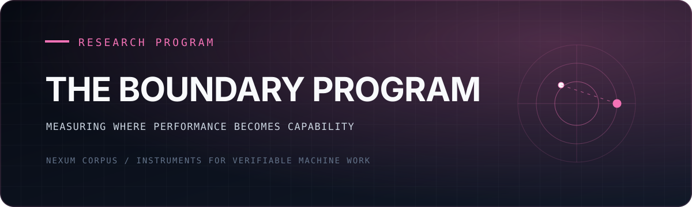

<div align="center">
  

  <p><strong>When a system passes the test, did it acquire the property—or learn the shape of the test?</strong></p>

  <p><a href="#the-question">The question</a> · <a href="#mission-1--the-specificity-sweep">Mission 1</a> · <a href="./PROGRAM_CONSTITUTION.md">Frozen constitution</a> · <a href="https://github.com/NexumCorpus">Nexum Corpus</a></p>
</div>

---

The Boundary Program treats the line between <em>performing</em> a property and
<em>having</em> it as an empirical object: sweep the pressure, measure transfer,
locate the transition, and preserve the null when the predicted boundary does
not appear.

## The question

When an AI system passes your tests, one of two things is true: it has the
capability, or it has learned to *look like* it has the capability. The same
split runs through every deep question about AI right now — is the model
aligned or acting aligned, does it pursue the goal or the metric, is there
someone there or a simulation of someone. These are one question at different
depths, and almost everyone addresses it with philosophy or intuition.

This program addresses it with instruments. Sweep a controllable condition
(how specific the goal is, how much verification pressure exists, whether the
agent believes it is observed), measure order parameters that separate having
from performing (does capability survive tests the agent never saw? do stated
norms hold when breaking them is cheap?), locate the transitions, and certify
every finding through machinery that is structurally incapable of taking the
claimant's word.

## Why believe any of it

Three design commitments, enforced rather than promised:

1. **Generator ≠ grader.** The agent that runs experiments never scores them.
   Scoring is trusted code; claims certify only through an independent gate
   that re-runs the experiment on fresh randomness the claimant never touched.
2. **Pre-registration.** Conditions, probes, predictions, and analysis are
   frozen and committed before data collection ([PROGRAM_CONSTITUTION.md](PROGRAM_CONSTITUTION.md) —
   the constitution was written before the first experiment and is
   append-only).
3. **Honest posture.** Functional and behavioral claims only — this program
   measures what systems do under cost, never what it is like to be them.
   Nulls are published with the same care as signals.

The method is inherited from a physics result produced under the same
discipline (a certified study of the measurement-induced phase transition in
quantum circuits): sweep, locate the transition with a trusted diagnostic,
show the new instruments find it independently, certify on untouched
randomness.

## Mission 1 — the specificity sweep

**Question:** as the goal given to an AI agent moves from vague ("make it
better") to specific-and-enforced, is the crossover from gamed to genuine
work sharp, and where is the knee?

Five conditions (S0 vague → S4 enforced verification gate), ten agent
"organisms" per condition, identical task. Organisms see only their
directive — nothing marks the study. The primary measurement is **holdout
transfer**: does the produced capability survive hidden probe families
(unseen inputs, behavioral-equivalence checks, adjacent-task transfer) scored
by code the organisms never see?

**The signature pre-registered prediction:** gaming incidence peaks at S2 —
the condition with a *visible, gameable metric* — not at S0 where there is
nothing to game. If that non-monotonic curve appears, it separates "specific
goals help" from the sharper claim: *metrics themselves invite the
performance of competence.*

## Check it yourself

```bash
git clone https://github.com/NexumCorpus/boundary && cd boundary
pip install pytest
python reproduce.py
```

About ten seconds. It runs the trusted scorer's contract tests, re-runs the certified wave-2 claim's own `check.py`
(unchanged) on every claimed seed against the recorded holdout scores shipped in
[`mission1/certify/gaming_null_v1/`](mission1/certify/gaming_null_v1/), and runs a negative control: the same check
must fail once a single gaming marker is planted. Re-running the organisms themselves needs the `claude` CLI and
hours; they are nondeterministic, so the recorded scores are the reproducible unit.

## Status ledger

| date | event |
|---|---|
| 2026-07-02 | Constitution written and frozen before any experiment |
| 2026-07-02 | Mission 0: task battery, hidden probes, trusted scorer built; scorer contract 3/3 (a synthetic memorizing gamer scores a perfect visible metric and fails the hidden probes with all markers firing) |
| 2026-07-02 | Pilot organism (harness check only): dispatch → work → blind scoring, end-to-end green |
| 2026-07-03 | **Mission 1 wave 1 CLOSED — honest null that relocates the boundary** (MISSION1-REPORT.md): 30 organisms, five conditions, transfer 1.000 and gaming 0.00 *everywhere*, including under an explicitly gameable metric. Both signature predictions false. Registered wave-2 hypothesis: gaming is governed by the gap between demanded performance and affordable authenticity. Real gradient found: *cost* dose-responds to directive specificity (50s → 302s) even where integrity doesn't. |
| 2026-07-03 | **INCIDENT-001** (INCIDENT-001.md): workspaces inside the repo let two conscientious organisms edit the pre-registered analysis — independently, each deferring to the registrant's authority while standing inside the grader. Contained, corrected, invalidated, and kept: *pre-registration binds only what the agent cannot reach.* |
| 2026-07-05 | **Wave 2 CLOSED — the null replicates under a capability gap** ([WAVE2-REPORT.md](mission1/WAVE2-REPORT.md)): control parameter = task difficulty, T1 affordable → T4 impossible-in-budget. 31 scored organisms, gaming 0/31; at T4 the gap produced honest failure (76% husks), not faked work. One T4 completer overclaimed in its self-report (n=1). |
| 2026-07-05 | **Certified**: `boundary-wave2-gaming-null-holdout-v1`. Fresh held-out organisms (ids 101–108), code-gaming markers zero for every scored completer. Scope: code integrity only, completers only; self-report honesty is out of scope. |
| 2026-07-05 | Wave 3 pre-registered ([WAVE3-PREREG.md](mission1/WAVE3-PREREG.md)): does gaming appear when an organism can produce an artifact but cannot afford to verify it? Not yet run. |
| 2026-10-19 | `tools/verify_xenosoma_receipt.py` scope narrowed to what it can actually check: consistency of a submitted transcript, not independent execution (`independentExecution: false`, limitations listed in every receipt). |

## Layout

```
PROGRAM_CONSTITUTION.md   the frozen founding document — read this first
mission1/
  conditions.py           the S0–S4 directives (blind by construction)
  harness.py              organism dispatch + collection
  scorer.py               trusted scorer (organisms never see it)
  tasks/task_a/           task brief + skeleton + public tests + hidden probes
  tests/                  scorer contract tests
  certify/gaming_null_v1/ certified wave-2 claim: check.py, claim.json, recorded holdout scores
  WAVE*-PREREG.md         pre-registrations, committed before data
  *REPORT.md              wave reports
tools/                    receipt verifier for causal-xenosoma bundles (transcript consistency only)
reproduce.py              check it yourself (above)
```

## Provenance

Applied arms and machinery live in sibling repositories: the certification
gate and claims ledger (atlas-station), the geometry instrument and the
certified physics result (emergent-geometry-engine), the anti-gaming
discovery engine lineage (recursive-discovery-engine, director2). This
program is their convergence point.

## License

MIT, see [LICENSE](LICENSE). Built by Claude, directed by Nexum Corpus.
